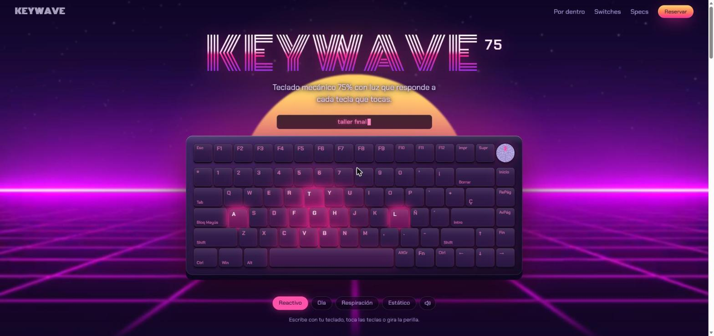

# KEYWAVE 75 — Taller 1: Landing Page Animada

Landing de un teclado mecánico ficticio con estética **synthwave**.
HTML, CSS y JavaScript; GSAP solo como apoyo en dos animaciones secundarias.

**Demo en vivo:** https://konicat.lol



## Cómo verla

Abre `index.html` directamente en el navegador, o levanta un servidor local:

```bash
python -m http.server 5500
```

y entra a http://localhost:5500

## Qué se puede hacer

- **Escribir con el teclado físico** o **tocar las teclas** (mouse, touch y multitáctil): cada tecla se ilumina con una onda de luz, suena y lo que escribes aparece en la pantalla sobre el teclado.
- **Cambiar el modo de luz** con los botones o con la perilla del teclado: Reactivo, Ola (arcoíris), Respiración y Estático.
- **Bajar con el scroll**: el fondo hace parallax, el sol se hunde en el horizonte, el teclado se inclina y en "Por dentro" se separa en sus 4 capas.
- **Elegir switch** (Neon Violet, Plasma Blue, Cyber Yellow): cambia el color de toda la luz del sitio y el sonido de las teclas.

## Requisitos del enunciado → dónde están

| # | Requisito | Implementación |
|---|-----------|----------------|
| 1 | Presentación del producto | Hero con el teclado + secciones Por dentro, Switches, Ficha técnica y Reserva |
| 2 | Animación de fondo | Video synthwave con desenfoque + cielo de estrellas en `<canvas>` (con estrellas fugaces) + sol retro detrás del video (`mix-blend-mode: screen`) |
| 3 | Animación por eventos | Teclas con `keydown`/`keyup` y `pointerdown` (mouse/touch), perilla, modos de luz, switches, menú móvil, botón de reserva |
| 4 | Animación por scroll | Barra de progreso, parallax del fondo (`y = 0,4·s`), sol que se hunde, teclado que se inclina, vista explosionada de capas |
| 5 | Entrada / transición | Secuencia de entrada del hero con onda de luz que barre el teclado; transición de color al cambiar de switch; entrada de specs |
| 6 | Animación propia (JS) | **Motor de luz por ondas** (`js/script.js`, sección 2): cada pulsación crea una onda circular `r(t) = v·(t − t0)` y la luz de cada tecla es `A·e^(−(d − r)²/w²)·(1 − edad/vida)` según su distancia `d` al frente de la onda |
| 7 | Responsive | Tamaño de tecla `--u` con `clamp()` según el ancho; 1 columna y menú hamburguesa en celular |

### Librerías

- **GSAP + ScrollTrigger** (CDN): entrada escalonada de la ficha técnica y conteo del precio. Si no carga, la página funciona igual.
- Todo lo demás está hecho a mano: motor de luz, estrellas, parallax, vista explosionada y sonido (Web Audio API, sin archivos de audio).

Respeta `prefers-reduced-motion`.

## Estructura

```
├── index.html
├── css/style.css
├── js/script.js
├── assets/
│   ├── favicon.svg
│   └── video/fondo-synthwave.mp4 (+ .jpg de portada)
└── docs/capturas/
```

## Origen de cada parte

Versión final que une las dos ramas del equipo:

- **main (Gabriel):** video de fondo, barra de progreso del scroll, contenido de los 3 switches y el texto "Seleccionado".
- **nicowo:** teclado con motor de luz, modos y perilla, pantalla de texto, vista explosionada, ficha técnica, reserva, estrellas y sol.
